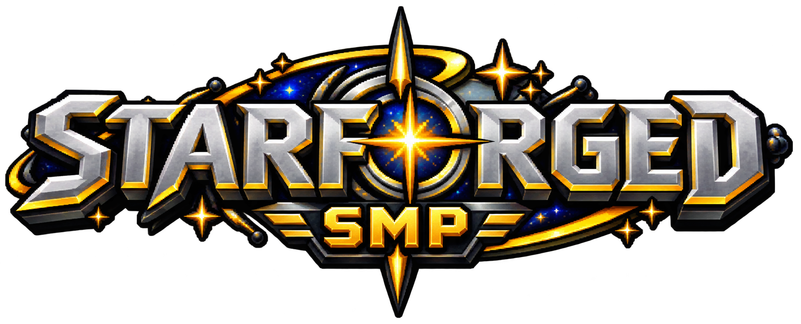

<h1 align="center">Markectomy</h1>

  I make Paper plugins and Fabric mods that feel at home in vanilla Minecraft. 
  Custom gameplay, creative tools, and systems that work together. 
  <a href="https://github.com/Markectomy?tab=repositories">Repositories</a> &middot;
  <a href="https://discord.gg/h7PX8Npcha">Project Discord</a>

## Tools I use

   
  Kotlin &middot; Java &middot; Gradle &middot; PostgreSQL 
   
  IntelliJ IDEA &middot; Git &middot; GitHub

## Projects

<h3 align="center">
  
  &nbsp; Axiom Blueprint Items
</h3>

  An unofficial Fabric addon that puts saved Axiom blueprints in your creative inventory. 
  Name search, tag filtering, rotating 3D previews, and Axiom's placement and undo controls. 
  <a href="https://github.com/Markectomy/axiom-blueprint-items">Source code</a> &middot;
  <a href="https://github.com/Markectomy/axiom-blueprint-items#installation">Setup &amp; docs</a> &middot;
  <a href="https://github.com/Markectomy/axiom-blueprint-items/blob/main/LICENSE">MIT license</a>

<h3 align="center">StarForgedSMP</h3>

   
  I also develop for StarForgedSMP. 
  My work includes skill-based leveling and ability systems, bounties, and claims. 
  <a href="https://discord.gg/sYRJK6XYzS">Server Discord</a> &middot;
  <code>starforgedsmp.net</code>

## Keeping it vanilla

Consistent pixel scale, blocky models, and familiar interfaces matter to me. Custom creatures, dialogue screens, and new mechanics should fit the game's existing style. I also like mechanics that happen in the world itself, like physical crafting interactions.

I build things, test them in-game, and refine the controls, visuals, and performance together while keeping the code manageable as the project grows.

## Elsewhere in Minecraft

- **Gameplay:** custom creatures, combat, progression, and mechanics that interact with the world.
- **Creative tools:** blueprints, building workflows, and interfaces that are useful when you're actually playing.
- **Beyond code:** resource packs, custom entity assets, map design, worldbuilding, and redstone.

---

  Bugs, ideas, or questions? Join my <a href="https://discord.gg/h7PX8Npcha">project Discord</a>. 
  

